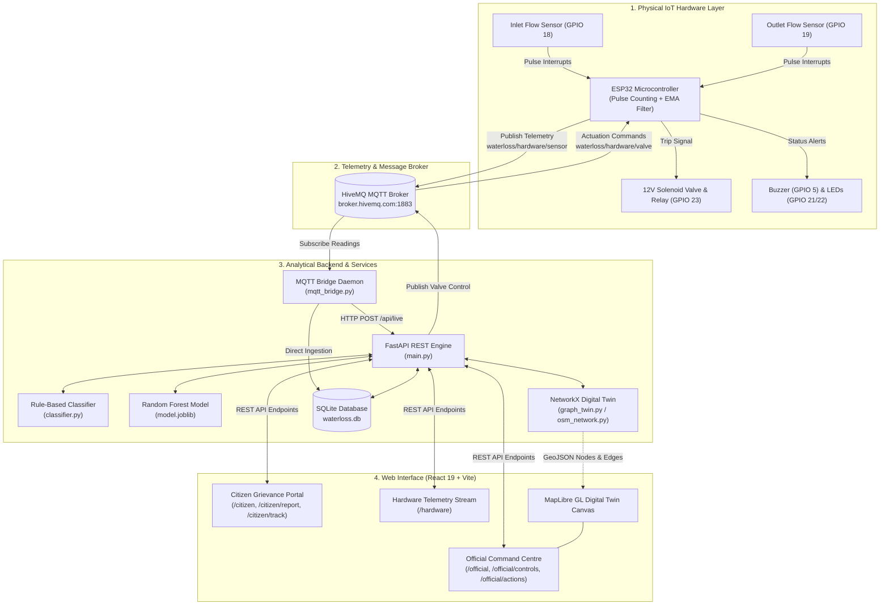
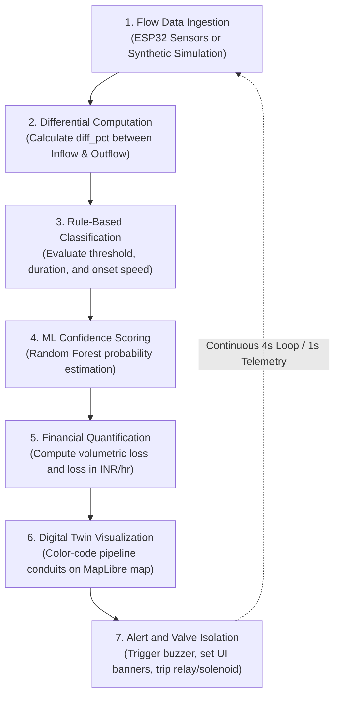
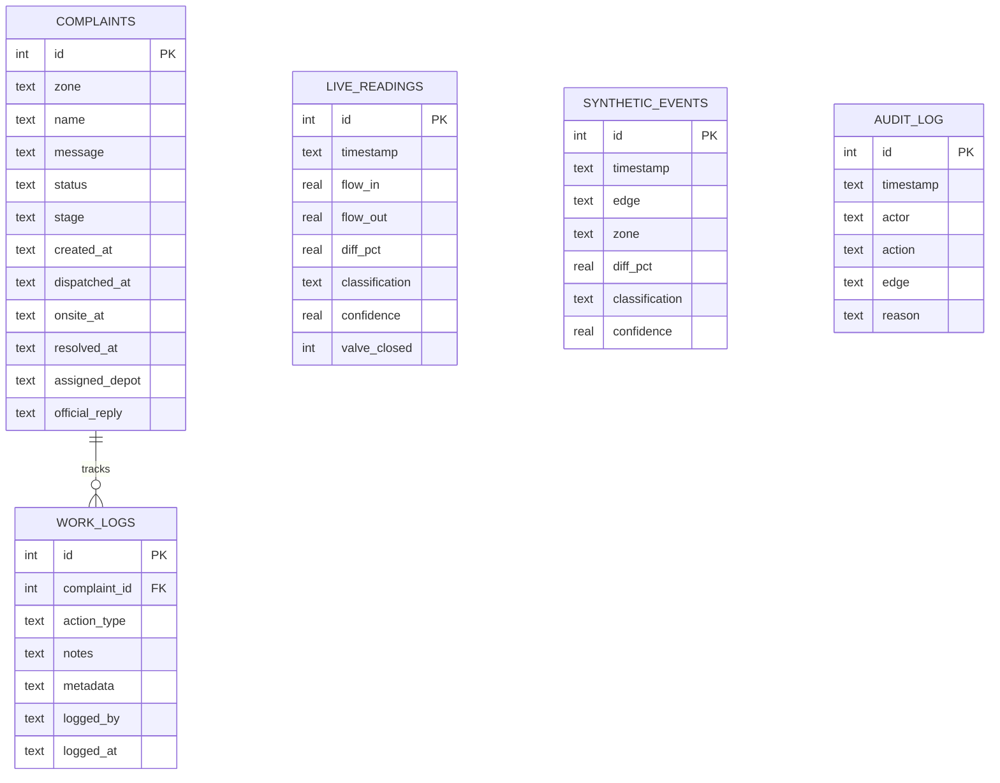

# Water Loss Isolation Engine

> Real-time pipeline monitoring, anomaly classification, and automated isolation system using an AI-assisted digital twin and IoT flow sensing.

---

## Overview

Non-Revenue Water (NRW)—treated municipal water lost prior to reaching paying consumers—is a critical challenge for urban water distribution networks. In many Indian and international metropolitan grids, a substantial proportion of treated water is lost through undetected pipe leaks, unauthorized tapping (theft), and sudden pipeline bursts. 

Traditional municipal water management relies primarily on manual foot inspections, periodic audit cycles, and citizen complaints. These methods introduce significant latency between the occurrence of a fault and field remediation, during which substantial water volumes and municipal revenues are permanently lost.

The **Water Loss Isolation Engine** addresses this challenge by providing an integrated cyber-physical monitoring and response platform. The system models an urban distribution network as a geospatial digital twin (tested using the road and pipeline topology of Bandra West, Mumbai) coupled with a physical IoT testbed powered by an ESP32 microcontroller and dual pulse flow sensors. By continuously tracking the differential between inlet and outlet flow, the engine classifies network states into **Normal**, **Leak**, **Theft**, or **Burst** using a hybrid rule-based and machine-learning pipeline. When severe anomalies are detected, the system can trigger audio-visual alarms and actuate a solenoid shutoff valve to isolate the affected segment, while simultaneously routing field maintenance teams through a dedicated operational portal.

---

## Key Features

- **Continuous IoT Flow Monitoring:** Measures real-time differential flow across pipeline segments at 1-second sampling intervals using dual YF-S201 Hall-effect flow sensors connected to an ESP32 microcontroller.
- **Hybrid Anomaly Classification:** Evaluates flow mismatches through a two-stage pipeline: a deterministic rule-based classifier that handles immediate threshold and onset analysis, accompanied by a trained Random Forest machine learning model providing probabilistic confidence scores.
- **Automated Physical Valve Isolation:** Supports hardware-level relay cutoffs and two-way MQTT control commands (`CLOSE` and `RESET`) to actuate a 12V solenoid valve, physically severing flow upon critical anomalies (mismatch $\ge 30\%$) or pipe bursts.
- **Geospatial Digital Twin Network:** Constructs an interactive pipeline graph from real-world road networks using OpenStreetMap (OSMnx) and NetworkX, rendered visually with MapLibre GL.
- **Tri-Mode Data Ingestion:** Accommodates real physical hardware streaming over MQTT, manual synthetic anomaly injections for operator testing, and preset demonstration scenarios.
- **Financial and Volumetric Loss Quantification:** Automatically converts active flow discrepancies into loss metrics, including Liters per minute, Liters per hour, and municipal monetary loss in Indian Rupees (₹/hour and ₹/day) based on municipal tariff rates.
- **Predictive Repair Diagnostic Cards:** Generates situational diagnostic summaries detailing anomaly severity, suspected failure mechanisms, recommended engineering actions, and dispatch urgency.
- **Citizen Grievance & Tracking Portal:** Provides an interface for citizens to submit geotagged water loss complaints, view regional supply advisories, and track maintenance lifecycles with shortest-path crew routing.
- **Municipal Official Command Centre:** Centralizes full-network status visualization, emergency override controls, citizen ticket dispatching, work-log tracking, and immutable operator audit logging.

---

## Technology Stack

| Category | Technology / Library | Description |
| :--- | :--- | :--- |
| **Frontend Framework** | React 19 | Component-based user interface architecture |
| **Build Tool** | Vite | Frontend bundler and local development server |
| **Styling** | Tailwind CSS | Utility-first CSS framework |
| **Map Visualization** | MapLibre GL 6 | Vector map rendering with CartoDB Dark Matter tiles |
| **Backend Framework** | FastAPI (Python 3.10+) | Asynchronous REST API framework with Pydantic validation |
| **ASGI Server** | Uvicorn | High-performance ASGI web server |
| **Database** | SQLite 3 (`waterloss.db`) | Relational database for complaints, telemetry, and audit logs |
| **Machine Learning** | Scikit-learn, Joblib | Random Forest classification and model serialization |
| **Data Processing** | NumPy, Pandas | Numerical analysis and rolling window time-series extraction |
| **Graph / Geospatial** | OSMnx, NetworkX, GeoPandas, Shapely | Pipeline network extraction and topological analysis |
| **IoT Protocol** | MQTT (`paho-mqtt`, `PubSubClient`) | Real-time telemetry broker transport (`broker.hivemq.com:1883`) |
| **Hardware** | ESP32 DevKit, YF-S201, 1-Ch Relay, Solenoid | Edge microcontroller, pulse flow meters, and 12V cutoff actuator |

---

## System Architecture

The Water Loss Isolation Engine operates across four primary interacting layers: the physical IoT edge, the cloud/MQTT communication layer, the FastAPI analytical backend, and the role-based React web interface.



---

## How the System Works

The system executes a seven-stage closed-loop evaluation workflow:



1. **Flow Data Ingestion:** Water flow passes through the physical test rig. The inlet and outlet sensors generate pulse signals counted via GPIO interrupts on the ESP32. Readings are smoothed using an Exponential Moving Average (EMA) filter. Telemetry is formatted as JSON and published to the MQTT topic `waterloss/hardware/sensor`.
2. **Differential Computation:** The difference between inlet flow ($Q_{in}$) and outlet flow ($Q_{out}$) is computed:
   $$\Delta Q\% = \max\left(0, \frac{Q_{in} - Q_{out}}{Q_{in}} \times 100\right)$$
3. **Rule-Based Classification:** The engine evaluates the mismatch against preset physical thresholds and temporal parameters (duration steps and onset slope) to classify the event as **Normal**, **Leak**, **Theft**, or **Burst**.
4. **Machine Learning Confidence Scoring:** A feature vector derived from the time-series flow window is dispatched to the trained Random Forest model (`/api/ml/predict`) to yield a secondary class prediction and confidence probability.
5. **Financial Quantification:** Volumetric water loss and equivalent financial impacts are computed using the benchmark municipal water rate ($\approx ₹0.07\text{ per Liter}$ or $₹70\text{ per } 1,000\text{L}$).
6. **Digital Twin Visualization:** The pipeline graph updates its edge attributes. Compromised segments change color dynamically on the MapLibre GL map (Normal = dark blue-grey, Leak = amber, Theft/Burst = red).
7. **Alert & Valve Isolation:** If the mismatch exceeds critical levels ($\ge 30\%$) or a pipe burst occurs, the system issues a command over MQTT (`waterloss/hardware/valve`) to de-energize the relay, closing the solenoid valve and severing pump power. Municipal officers can review dispatch routes and track remediation progress through the complaint workflow.

---

## Project Structure

```text
water-loss-isolation-engine/
├── backend/
│   ├── esp32_water_loss/
│   │   └── esp32_water_loss.ino     # ESP32 C/C++ firmware (pulse counting, relay, MQTT)
│   ├── ml/
│   │   ├── generate_dataset.py      # Synthetic time-series telemetry generator
│   │   ├── train_model.py           # Random Forest training script using scikit-learn
│   │   └── model.joblib             # Serialized Random Forest model bundle
│   ├── classifier.py                # Deterministic rule-based classification logic
│   ├── db.py                        # SQLite schema definitions and database helper routines
│   ├── graph_twin.py                # NetworkX digital twin simulation and anomaly injection
│   ├── main.py                      # FastAPI server, background simulation loop, REST APIs
│   ├── mqtt_bridge.py               # Serial and MQTT bridge daemon with simulation mode
│   ├── osm_network.py               # OSMnx OpenStreetMap street network graph builder
│   ├── requirements.txt             # Python backend dependencies
│   └── water_loss.db                # Active SQLite database file
├── frontend/
│   ├── public/                      # Static web assets
│   ├── src/
│   │   ├── components/
│   │   │   ├── AppLayout.jsx        # Layout shell with role-aware headers
│   │   │   ├── MapView.jsx          # MapLibre GL interactive pipeline network map
│   │   │   ├── ResidualChart.jsx    # Real-time SVG time-series residual chart
│   │   │   ├── Sidebar.jsx          # Dashboard navigation menu
│   │   │   └── TickStatusBanner.jsx # Simulation state banner
│   │   ├── pages/
│   │   │   ├── CitizenHome.jsx      # Citizen portal overview and locality status
│   │   │   ├── CitizenNotices.jsx   # Public maintenance and outage notices
│   │   │   ├── CitizenReport.jsx    # Citizen complaint submission form
│   │   │   ├── HardwareLive.jsx     # Live ESP32 hardware telemetry and valve controls
│   │   │   ├── Login.jsx            # Multi-role authentication page
│   │   │   ├── OfficialActions.jsx  # Complaint ticket queue and crew dispatch routing
│   │   │   ├── OfficialControls.jsx # Manual anomaly injection and isolation panel
│   │   │   ├── OfficialHome.jsx     # Official digital twin command centre
│   │   │   └── TrackComplaint.jsx   # Complaint lifecycle tracking and impact metrics
│   │   ├── utils/
│   │   │   └── aiDiagnostics.js     # Financial loss formulas and diagnostic messages
│   │   ├── api.js                   # Axios HTTP client configured for FastAPI backend
│   │   ├── App.jsx                  # React Router route hierarchy and role protection
│   │   ├── index.css                # Global stylesheet and custom component classes
│   │   └── main.jsx                 # Application entry point
│   ├── package.json                 # Node.js dependencies and build scripts
│   ├── tailwind.config.js           # Tailwind theme and styling configuration
│   └── vite.config.js               # Vite bundler configuration
└── README.md                        # Project documentation
```

---

## Installation and Setup

### Prerequisites

Ensure the following environments and tools are installed:

- **Python:** Version 3.10 or higher
- **Node.js:** Version 18.0.0 or higher (with `npm`)
- **Arduino IDE:** Version 2.0+ (required only if uploading firmware to physical ESP32 hardware)
- **Git:** Version control client

---

### Step 1: Clone the Repository

```bash
git clone https://github.com/lyreb11-art/water-loss-isolation-engine.git
cd water-loss-isolation-engine
```

---

### Step 2: Backend Setup

1. Open a terminal and navigate to the `backend` directory:
   ```bash
   cd backend
   ```
2. Create and activate a Python virtual environment:
   - On Windows (PowerShell):
     ```powershell
     python -m venv venv
     .\venv\Scripts\Activate.ps1
     ```
   - On Linux / macOS:
     ```bash
     python3 -m venv venv
     source venv/bin/activate
     ```
3. Install required Python packages:
   ```bash
   pip install -r requirements.txt
   ```
4. Verify the database:
   The SQLite database file (`waterloss.db`) will initialize automatically when the FastAPI application starts.

---

### Step 3: Frontend Setup

1. Open a new terminal and navigate to the `frontend` directory:
   ```bash
   cd frontend
   ```
2. Install Node dependencies:
   ```bash
   npm install
   ```

---

### Step 4: (Optional) ESP32 Firmware Flashing

If deploying on physical hardware:
1. Open [`backend/esp32_water_loss/esp32_water_loss.ino`](backend/esp32_water_loss/esp32_water_loss.ino) in the Arduino IDE.
2. Install the **PubSubClient** library via the Arduino Library Manager.
3. Configure your local Wi-Fi credentials in the sketch:
   ```cpp
   const char* WIFI_SSID     = "YOUR_WIFI_SSID";
   const char* WIFI_PASSWORD = "YOUR_WIFI_PASSWORD";
   ```
4. Connect the ESP32 board via USB, choose the target COM port, and upload the sketch.

---

## Running the Application

To run the complete system locally, launch the backend server, the telemetry bridge, and the frontend development server across separate terminal windows.

### Terminal 1: Backend API Server
```bash
cd backend
# Ensure virtual environment is activated
uvicorn main:app --reload --port 8000
```
*The FastAPI server will start on `http://localhost:8000`. API documentation is accessible at `http://localhost:8000/docs`.*

---

### Terminal 2: MQTT Telemetry Bridge
The bridge captures sensor readings from the MQTT broker or generates simulated telemetry for demonstration.

- **Option A — Live Hardware Mode (Listening to real ESP32 over MQTT):**
  ```bash
  cd backend
  python mqtt_bridge.py
  ```

- **Option B — Standalone Simulation Mode (Generates live flow cycles without hardware):**
  ```bash
  cd backend
  python mqtt_bridge.py --simulate
  ```

---

### Terminal 3: Frontend Web Application
```bash
cd frontend
npm run dev
```
*The application interface will be accessible at `http://localhost:5173`.*

---

## Usage

### 1. Portal Access & Roles

Upon opening the application at `http://localhost:5173`, users are presented with three access options on the Login page:

| Portal | Route | Access Type | Credentials | Description |
| :--- | :--- | :--- | :--- | :--- |
| **Citizen Portal** | `/citizen` | Role-based | Any name, password: `citizen123` | Report leaks, view regional notices, and track repair tickets. |
| **Official Portal** | `/official` | Role-based | Username: `admin`, password: `admin123` | Full network monitoring, anomaly injection, and crew dispatch. |
| **Hardware Live** | `/hardware` | Public | *No login required* | Direct live sensor metrics, status indicators, and valve controls. |

---

### 2. Standard Workflows

#### A. Monitoring Live Hardware
1. Navigate to the **Hardware Live** portal (`/hardware`).
2. Observe the real-time inlet and outlet flow meters (L/min), differential percentage ($\Delta Q\%$), and the active system state.
3. Use the **Emergency Cutoff** button to manually trip the 12V relay/solenoid via MQTT, or use **Restore Supply** to resume flow.

#### B. Simulating Network Anomalies (Official Portal)
1. Log in as an **Official** (`admin` / `admin123`) and open `/official`.
2. Inspect the Bandra West street network map; all healthy conduits appear in dark blue-grey.
3. Open **Demo Controls** (`/official/controls`).
4. Select a pipeline segment, choose an event type (**Leak**, **Theft**, or **Burst**), and click **Inject Anomaly**.
5. Return to the map to observe the segment change color (amber for Leak, red for Theft/Burst) and watch the residual time-series chart record the mismatch.
6. To restore normal conditions, click **Unisolate** or use **Clear All Anomalies**.

#### C. Citizen Complaint Lifecycle & Crew Dispatch
1. Log in as a **Citizen** (`/citizen`) and navigate to **Report Issue** (`/citizen/report`).
2. Select your locality (street name), specify the issue type (e.g., Leak, Low Pressure), enter a description, and submit.
3. Switch to the **Official Portal** and open the **Action Centre** (`/official/actions`).
4. Locate the newly filed complaint in the queue and click **Dispatch Crew**.
5. The system computes the shortest path from the depot to the affected conduit along the actual road network, calculates estimated resolution metrics, and generates an updated work log.
6. Track the complaint status live from `/citizen/track/:id`.

---

## API / Backend Overview

The FastAPI backend exposes endpoints for digital twin state management, anomaly simulation, telemetry ingestion, and complaint handling:

| Method | Endpoint | Purpose | Key Input | Response / Output |
| :--- | :--- | :--- | :--- | :--- |
| `GET` | `/api/graph` | Retrieves the active pipeline network topology. | None | JSON containing nodes, edges, flows, coordinates, and statuses. |
| `POST` | `/api/graph/load` | Ingests a new geographic network via OSMnx. | `{"place_name": "string"}` | Ingestion status and node/edge count. |
| `POST` | `/api/simulate/step` | Reads the current digital twin simulation state. | None | Last tick results, graph data, and residual history. |
| `POST` | `/api/simulate/tick` | Manually advances the simulation clock by 1 tick. | None | Updated network flow states and classifications. |
| `POST` | `/api/simulate/inject` | Injects an anomaly into a specific pipe segment. | `{"edge_id": "u__v", "event_type": "leak\|theft\|burst"}` | Confirmation of injected fault. |
| `POST` | `/api/simulate/unisolate` | Clears isolation on a single edge segment. | `{"edge_id": "u__v", "actor": "admin"}` | Restoration confirmation. |
| `POST` | `/api/simulate/clear-all` | Resets all active anomalies across the network. | `{"actor": "admin"}` | Number of cleared pipeline segments. |
| `GET` | `/api/live` | Fetches recent time-series telemetry from hardware. | Optional `limit` query param | Array of recent sensor readings and latest active record. |
| `POST` | `/api/live` | Ingests sensor readings; triggers auto-cutoff if $\ge 30\%$. | `flow_in`, `flow_out`, `diff_pct`, `classification` | Ingestion status and `valve_closed` state. |
| `POST` | `/api/valve` | Publishes valve actuation command via MQTT. | `{"closed": true\|false}` | Dispatched command (`CLOSE` or `RESET`). |
| `POST` | `/api/ml/predict` | Computes classification using the Random Forest model. | 6 rolling-window flow features | Predicted `label` and `confidence` score. |
| `GET` | `/api/complaints` | Lists all citizen complaints. | None | Array of complaint records with status and stage. |
| `POST` | `/api/complaints` | Submits a new citizen complaint. | `{"zone": "...", "name": "...", "message": "..."}` | Creation confirmation. |
| `POST` | `/api/complaints/{id}/dispatch` | Dispatches field crew with road routing. | `{"depot_node": "...", "note": "..."}` | Polyline route coordinates and target node. |
| `GET` | `/api/complaints/{id}/impact` | Calculates water, financial, and environmental savings. | `id` (path parameter) | `water_saved_lpd`, `cost_saved_per_day`, `households_served`. |

---

## Machine Learning / AI

### Purpose
The machine learning pipeline provides secondary classification and confidence verification for flow anomalies. While rule-based thresholds execute instantaneously for clear-cut bursts, the ML model disambiguates edge cases between small leaks and unauthorized usage by analyzing the temporal signature of the flow rate.

### Model Architecture
- **Algorithm:** Random Forest Classifier (`RandomForestClassifier`)
- **Hyperparameters:**
  - `n_estimators`: 200 trees
  - `max_depth`: 10
  - `random_state`: 42
  - `n_jobs`: -1 (parallel processing)

### Input Features
The model operates on a 6-dimensional rolling feature vector:

| Feature Name | Type | Description |
| :--- | :--- | :--- |
| `diff_pct` | Float | Current percentage difference between inlet and outlet flow. |
| `diff_pct_lag1` | Float | Mismatch percentage recorded at the previous simulation step ($t-1$). |
| `diff_pct_lag3` | Float | Mismatch percentage recorded 3 steps prior ($t-3$). |
| `slope` | Float | Rate of change of the mismatch over the recent observation window ($\frac{\Delta Q\%}{\Delta t}$). |
| `duration_steps` | Integer | Consecutive simulation ticks during which an anomaly has persisted. |
| `flow_in_norm` | Float | Inlet flow rate normalized against nominal network operating capacity. |

### Training & Dataset
- **Dataset Generation (`backend/ml/generate_dataset.py`):** Synthesizes balanced time-series telemetry containing 1,500 samples per class across four categories: **Normal**, **Leak**, **Theft**, and **Burst** (6,000 total samples). Each scenario incorporates randomized severity, onset slope, and transient sensor noise.
- **Model Training (`backend/ml/train_model.py`):** Splits the dataset into an 80% training set and a 20% stratified test set. The trained estimator and feature names are serialized into `backend/ml/model.joblib`.
- **Inference (`backend/main.py`):** The model is loaded into memory on server startup. The `/api/ml/predict` endpoint accepts candidate feature vectors and returns the predicted class alongside the maximum class probability (`confidence`).

---

## Database

The project uses an embedded **SQLite 3** relational database (`waterloss.db`), managed via Python's native `sqlite3` driver in `backend/db.py`.



### Table Summary
- **`complaints`:** Stores public grievance tickets, locality associations, resolution stages (`reported`, `dispatched`, `onsite`, `resolved`), and timestamps.
- **`work_logs`:** Maintains sequential action entries logged during complaint resolution (e.g., crew arrival, pipe replacement, pressure test).
- **`live_readings`:** Captures time-series telemetry received from the physical ESP32 or MQTT bridge, recording flow rates, mismatch percentages, and valve states.
- **`synthetic_events`:** Logs anomaly injection events created during digital twin simulation runs.
- **`audit_log`:** Records administrative actions (e.g., anomaly injections, unisolations, network resets) for operator accountability.

---

## Results / Output

### 1. Classification Performance (Test Scenarios)
Evaluation of the classification logic across representative scenarios documented in the project testing report:

| Test Scenario | Mismatch ($\Delta Q\%$) | Expected Class | Predicted Class | Model Confidence |
| :--- | :--- | :--- | :--- | :--- |
| **Normal Flow** | 2.1% | Normal | Normal | 0.98 |
| **Slow Leak** | 14.3% | Leak | Leak | 0.82 |
| **Water Theft** | 28.7% | Theft | Theft | 0.91 |
| **Pipe Burst** | 72.5% | Burst | Burst | 0.96 |
| **Transient Noise** | 6.8% | Normal | Normal | 0.95 |

The trained Random Forest model achieved **87.13% test accuracy**, an **F1-score of 82.76%**, and an **ROC-AUC of 0.9175** on the stratified synthetic validation set.

### 2. Observable System Outputs
- **Interactive Geospatial Visualization:** Real-time color rendering of pipeline segments on the MapLibre map reflecting operational states (Normal, Leak, Theft, Burst, Isolated).
- **Residual Hydraulic Chart:** Real-time SVG polyline tracking the peak percentage mismatch over the previous 40 simulation ticks with a 10% threshold marker.
- **Physical Rig Actuation:** Physical closing of the 12V solenoid valve and pump cutoff when differential flow exceeds 30% or when commanded via the web interface.
- **Field Routing & Impact Metrics:** Shortest-path route generation along actual road coordinates connecting maintenance depots to complaint locations, outputting calculated daily water volume conserved and monetary savings.

---

## Limitations

1. **Single-Segment Physical Rig:** The physical hardware testbed models a single pipeline conduit with dual sensors (inlet and outlet). While the software digital twin supports complex multi-node networks, physical hardware testing is currently confined to a single pipe testbed.
2. **Synthetic Training Dataset:** Due to the absence of public, high-resolution municipal time-series telemetry containing verified water theft and burst labels, the Random Forest model is trained on synthesized flow profiles calibrated against theoretical hydraulic patterns.
3. **Public MQTT Broker Dependency:** The system defaults to the public HiveMQ broker (`broker.hivemq.com:1883`), which is unauthenticated and intended for testing and demonstration. Production deployments require a secured, private MQTT broker with TLS.
4. **Single-Node Database:** SQLite is utilized as the database layer. While appropriate for local execution and demonstration, it does not support high-concurrency multi-instance scaling.
5. **Geocoding & Map Data Availability:** Dynamic region extraction relies on the live OpenStreetMap Overpass API via OSMnx. Locations with incomplete OSM road metadata may require fallback to offline mock coordinates.

---

## Future Scope

1. **Automated District Metered Area (DMA) Partitioning:** Implement automated graph clustering algorithms to subdivide extensive urban water networks into manageable, isolated monitoring zones.
2. **Multi-Zone Physical Hardware Integration:** Expand the physical testbed to feature multiple interconnected nodes with individual solenoid isolation valves across branches.
3. **Acoustic Sensor Fusion:** Combine flow telemetry with acoustic/vibration hydrophone data to detect micro-leaks and structural degradation before surface ruptures occur.
4. **Enterprise Database Migration:** Migrate the storage layer to PostgreSQL with PostGIS for spatial querying and time-series extensions (such as TimescaleDB).
5. **Standards Compliance Monitoring:** Incorporate formal compliance dashboards aligned with municipal water standards such as CPHEEO (Central Public Health and Environmental Engineering Organisation) and IS 1172.
6. **Carbon Footprint Tracking:** Account for pump energy consumption across distribution elevation profiles to report net greenhouse gas emission reductions achieved through prompt leak isolation.

---

## References

1. R. P. Rolle, W. C. Rodrigues, L. R. Tomazini, L. N. Monteiro, and E. P. Godoy, *"Leveraging Graph-Based Leak Localization in Water Distribution Networks,"* 2024.
2. D. U. Leonzio, P. Bestagini, M. Marcon, G. P. Quarta, and S. Tubaro, *"Robust Water Leak Detection and Localization with Graph Signal Processing,"* 2023.
3. R. Yasin, S. Ari, and A. Aljer, *"DBSCAN-Leak, Novel Real-Time Water Leak Detection: A Case Study of SunRise Demonstrator,"* 2026.
4. H. Liu, J. Jiang, X. Zhang, Y. Ding, L. Yang, and S.-H. Yang, *"Leak Detection and Localization in Water Distribution Networks via Online Change-Point Detection and Leak Sensitivity Modeling,"* 2024.
5. M. R. Islam, S. Azam, B. Shanmugam, and D. Mathur, *"A Review on Current Technologies and Future Direction of Water Leakage Detection in Water Distribution Network,"* 2022.
6. **OSMnx Documentation:** Boeing, G. (2017). *OSMnx: New methods for acquiring, constructing, analyzing, and visualizing complex street networks.* Computers, Environment and Urban Systems, 65, 126–139.
7. **FastAPI Framework:** https://fastapi.tiangolo.com/
8. **MapLibre GL:** https://maplibre.org/


